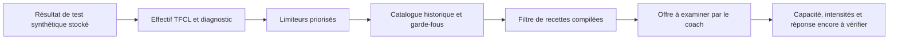

# Sélection structurée et traçabilité physiologique

La couche V17 réutilise les filtres historiques via `evaluateCanonicalOffer` : objectif, phase, niveau, prérequis, contexte, intention explicitement documentée et durée. Elle ajoute la complétude de recette et une instanciation source, puis vérifie les fenêtres déclarées et l'indisponibilité d'une discipline lorsqu'elles sont fournies. Une fenêtre disponible n'est pas une preuve de capacité physiologique.

## Sensibilité exécutée

Même contexte IM de test : estimation VLamax0,2→0,9. Les fonctions réelles produisent respectivement `['TTE', 'FTP/kg', 'VO2max']` et `['VLamax', 'TTE', 'FTP/kg', 'VO2max']`. Le catalogue contient 10 puis 12 fiches dont la recette générique est compilée ; l'ordre et les offres sont conservés dans [selection-sensitivity.json](evidence/selection-final/selection-sensitivity.json). Ce sont des candidats de revue, pas autant de prescriptions admissibles.

La chaîne commence au résultat estimé de test déjà stocké, pas à une acquisition de lactate ou au calcul brut d'un sprint. Les contrats/limiteurs sont réellement calculés ; les données d'entrée restent synthétiques. Le choix physiologique optimal de dose et une réponse réelle ne sont pas démontrés.

Pour le cœur générique de la fiche réelle `A_RUN_Z2_EASY`, 45 min peuvent être instanciées en conservant les éducatifs explicitement optionnels dans le témoin. La variante propre à un objectif reste explicitement non résolue : cette instanciation ne valide pas une variante Marathon ou IM. Une intention mlss incompatible, une durée hors source, un créneau trop court ou une discipline indisponible restent refusés. Un repère de vitesse seuil effectif explicitement fourni modifie l'affichage du domaine selon la doctrine, sans augmenter automatiquement les minutes. Une limite propre à la fiche n'est jamais écrasée par une plage générique.

## Contrat optionnel de résistance à la fatigue

`CoachFatigueResistance` contient une appréciation qualitative low/typical/high/unknown, un sport, une date valide, une source, une base descriptive et une incertitude. Il n'ajoute pas de questionnaire quantitatif de charge ni de champ obligatoire pour toute séance fondamentale.

L'avis reste distinct du niveau d'entraînement et de l'état de fatigue récent. Un avis high ne prouve pas la récupération observée et ne franchit pas une capacité déclarée. Une progression au-delà de l'enveloppe reste `conditional_pending_reassessment` ; une demande actuelle dépassant une limite fournie reste `not_admissible`. Un champ `observedRecovered` ajouté à cet avis est refusé : il appartient à un contrat d'observation distinct.

L'absence d'avis ne bloque pas la revue d'une séance fondamentale. Low et high ne fabriquent pas deux doses différentes si les autres preuves sont identiques. Le champ n'existe pas encore comme liaison opérationnelle de production : V17 propose et teste le contrat offline, sans modifier l'interface.
