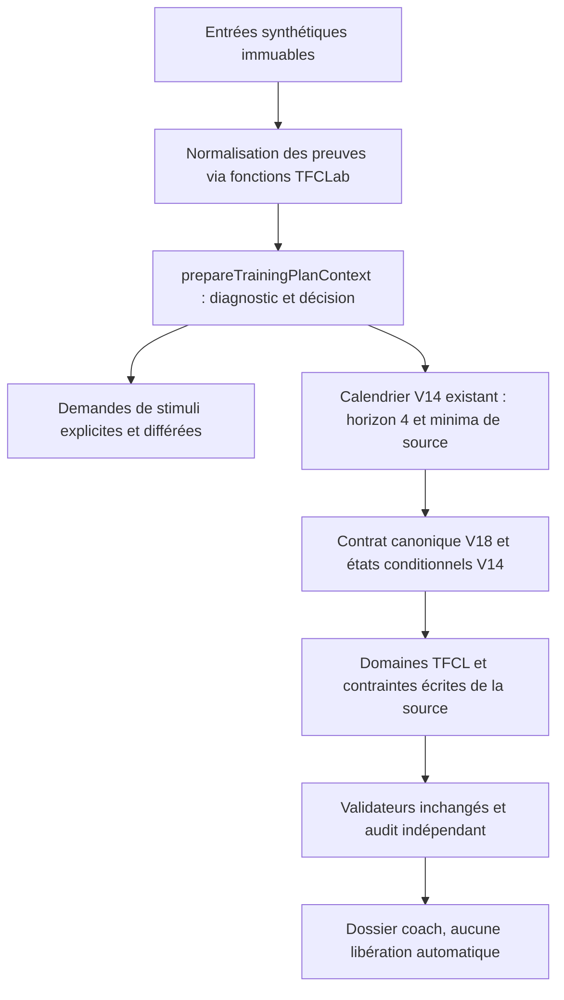

# Capacités du moteur effectivement exercées

**DRAFT — NO-GO.** Chaque classement ci-dessous s’appuie sur les appels réels des tests V22 (27 tests), la comparaison archivée et 175 tests de non-régression. « Opérationnelle » décrit une fonction et sa portée, jamais une approbation sportive ou scientifique.

| Capacité | État constaté | Fonctions réutilisées ou étendues | Preuve exécutée / limite |
|---|---|---|---|
| 1. Prioriser les limiteurs | Opérationnelle sur données disponibles ; bloquée par les données manquantes de C | prepareTrainingPlanContext → computeDiagnostic / computeDecision ; normalizeV22Evidence | TTE observés 65 et 28 conservés, origine VLamax terrain ; C reste unknown malgré le faux déficit de la sortie brute |
| 2. Choisir une adaptation | Partielle | decision.strategy.levers ; deriveV22StimulusRequests | A demande VO₂, B fondation/soutien du maintien d’intensité ; force/HIIT restent différés si leurs préconditions manquent |
| 3. Sélectionner une famille de stimuli | Partielle | prospectivePool, buildProspectiveCalendar, evaluateV18ReviewOffer | Pont explicite lever → familles du catalogue, puis filtres existants ; pas de dose d’intervalle tolérée démontrée ni de nouveau quota HIIT |
| 4. Individualiser les intensités | Partielle | resolvePhysiologicalReferences, getDoctrineDomain, deriveTrainingZones ; resolveV22Targets | Conversion W/vitesse et intersection avec la limite FTP écrite ; refus de l’ancre course A et des ancres C ; nage technique/multi-nages non résolue par CSS crawl |
| 5. Déterminer une dose admissible | Partielle | targetedTiming, explicitDose, evaluateV18ReviewOffer / instantiate, assessConditional | Minima de source et floors natifs réservés ; 31 témoins canoniques aux doses réservées sur 90, pas 90 doses complètes ; preuve individuelle toujours distincte |
| 6. Organiser un microcycle | Opérationnelle pour les réservations ; partielle pour une prescription | allocate / priorityIntent opt-in technique, puis calendrier V14 réutilisé | Première semaine construite au lieu du refus swim ; fréquences et jours conservés ; aucune source technique fictive ni séance approuvée |
| 7. Construire un mésocycle | Partielle | buildProspectiveCalendar avec horizon borné quatre semaines | 3 calendriers structurels, 1 candidat conditionnel B ; A/C gardent des refus, tous gardent la lecture historique brute non conforme |
| 8. Ajuster après réévaluation | Partielle | resolveInSimulation réutilisé via reassessV22 ; anciens nextWeekFeedback testés | Inconnu maintient l’attente, adverse interdit, favorable ne lève que 2 des 5 conditions ciblées ; aucun gain de capacité ni changement de dose inféré |

## Architecture : extension de fonctions existantes

Aucun second solveur, service, moteur de zones ou questionnaire créé. Les modèles antérieurs restent disponibles. Trois fichiers expérimentaux existants sont étendus avec défaut inchangé ; production et validateurs historiques restent bit-identiques. L’option technique V10 améliore le microcycle ; son ancien mésocycle strict reste limité par la réutilisation de la même source lorsque le floor change. Le prospectif réutilise donc le moteur V14 déjà présent, pas une réécriture de V11.

Les nombres de dose sont des conventions de programmation sourcées, pas des optimums. Les textes de prescription historiques dans les leviers, y compris des progressions chiffrées, sont conservés comme sorties brutes et ne deviennent pas automatiquement des règles adoptées.
