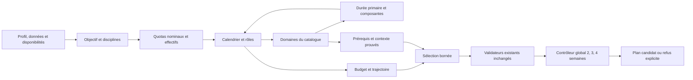

# DET-ENGINE V4 — contrats explicites, hors production

Les 600 configurations historiques et le dernier candidat V3 restent une cohorte immuable. Les nouvelles fixtures trail constituent une autre cohorte. Les variantes Ironman sont évaluées sur le sous-ensemble historique de 40 cas continus, sans multiplier le nombre de configurations uniques.

Un domaine vide n'est pas réparé par davantage de permutations. Un refus dans un placement et un catalogue donnés n'est pas une preuve d'impossibilité physiologique globale. Les témoins de domaine utilisent les métadonnées complètes ; la projection résumée du prévalidateur n'est pas suffisante pour vérifier une compatibilité sportive.

## Familles de conflits

| Conflit | Nature | Correction ou traitement V4 |
|---|---|---|
| Brick d'introduction utilisé comme endurance longue vélo | Contrat/calendrier/catalogue | Distinguer transition, composante vélo et endurance autonome ; ne jamais étirer la fiche. |
| Durée primaire différente de la somme des composantes explicites | Catalogue | Intersection des plages et allocation vélo/course dans les bornes originales. |
| Suppression d'un brick nominal sans conversion du total effectif | Implémentation du contrat candidat | Réutiliser `effectiveSessionQuota` pour conserver le même comptage physique. |
| Activation choisie selon « race week » plutôt que date de compétition | Calendrier | Utiliser les événements déclarés et le vrai J−1, y compris les objectifs intermédiaires. |
| Activation en Z3/Z4 face à un contrat commun allégé limité à Z1/Z2 | Contrats méthodologiques incompatibles | Conserver les variantes, dont un affûtage conservateur ; aucune modification du validateur. |
| Interdiction d'une discipline requise par un contrat de continuité | Contraintes contradictoires dans ce contrat | Refuser explicitement ; ne pas transformer automatiquement l'objectif ou l'ambition. |
| Géométrie trail absente et calendrier dédié manquant | Données insuffisantes + implémentation absente | Ne pas remplir les cas historiques. Construire seulement à partir de fixtures nouvelles explicites. |
| Attribution chronologique consommant le budget avant la sortie longue | Implémentation du générateur | Réserver les minima des rôles restants avant de choisir une dose. Aucun minimum catalogue abaissé. |
| Prérequis d'une insertion de réparation sans canal de confirmation | Interface réutilisée hors contexte | Génération : éligibilité catalogue existante + preuve explicite des capacités. La décision originale d'insertion reste enregistrée. |
| Drapeau de séance clé et répartition d'intensité insuffisamment détaillés | Annotations / modèle de dose | Limite conservée ; ne pas modifier les drapeaux ou les sévérités pour rendre un plan vert. |

Les 91 configurations du premier audit portant un témoin « introduction contre plancher long » signalent une incompatibilité entre **cette fiche et ce créneau**. Elles ne prouvent pas que tous les autres candidats du domaine sont absents. Le diagnostic final des domaines et les issues de prévalidation complètent ce premier graphe.

## Réutilisation

Préparation et individualisation : `prepareTrainingPlanContext`, `prepareGenerationContracts`, priorités de limiteurs et risque existants. Calendrier : `buildPeriodizationCalendar`, `inferWeekType`. Comptage : `effectiveSessionQuota`. Catalogue : métadonnées complètes, `catalogueEligibility`, `checkSessionCatalogue`, contrat d'équivalence de réparation. Validation : `validateWeeklyQuotas`, `validatePlan` avec contexte complet, B13/B14/B15 et schéma `zPlanChunk`.

Seul le moteur **expérimental** reçoit deux points d'extension facultatifs : filtre de candidat et intersection de dose. Sans contrat candidat, son chemin par défaut est conservé. Aucun composant de l'application, des fonctions Edge de production ou des données n'est modifié.

## Contrôleur global

Il expose les minutes par discipline, les briques non allouables, les sorties longues, les D+/D− connus et inconnus, les expositions excentriques et course/marche. Les fenêtres glissantes de 2, 3 et 4 semaines conservent récupération, affûtage et compétitions comme contexte distinct.

Les plafonds existants sont vérifiés lorsqu'ils existent. Aucun taux universel de risque ou de tolérance n'est ajouté. Une semaine déclarée de récupération qui ne diminue pas est un avertissement méthodologique, pas une loi clinique. Les doses de compétition déclarées sont séparées de l'entraînement.

Une reconstruction complète est comparée au dernier prototype : aucun nouvel échec critique, aucune nouvelle alerte ou aggravation suivie, aucune augmentation cachée des fenêtres de charge pour une correction de réduction. Si le gain n'est pas démontré, le précédent reste retenu. Les candidats bruts et leurs rejets restent publiés. Un plan nouvellement assemblé reste **non validé sportivement**, même s'il n'a pas de prédécesseur.
