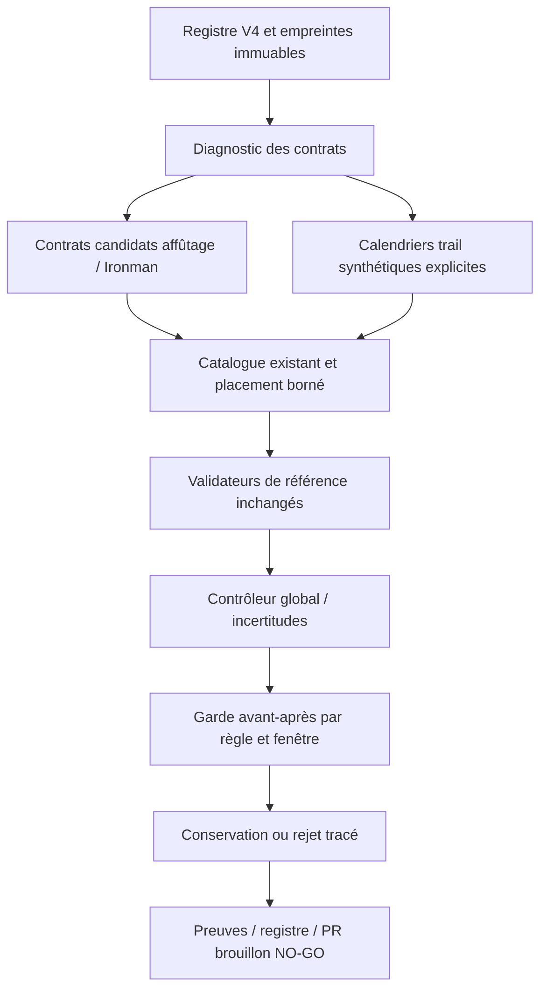

# Architecture expérimentale V5

Aucun service supplémentaire. Le moteur et les scripts restent hors application. La chaîne existante profil → limiteurs → phases → quotas → catalogue → calendrier → validation est conservée.

Réutilisation : `prepareGenerationContracts`, `buildPeriodizationCalendar`, `inferWeekType`, `buildCoachVolumeBudget`, `buildWeeklySlotLayout`, `effectiveSessionQuota`, `evaluateRepairSportingEquivalence`, `checkSessionCatalogue`, les validateurs existants, le garde de qualité V3 et la sélection de plan entier V4. Pas de copie d'un moteur de prescription stable. Les fonctions de remplacement isolé ne sont pas utilisées pour explorer des permutations massives.

## Conflits et causes

| Symptôme | Cause vérifiée | Action V5 |
|---|---|---|
| Décharges absentes dans le contrôle de contenu | Le thème ne portait que la phase ; type calendrier distinct | Réparer le libellé uniquement si décharge planifiée et réduction réelle conforme au plafond existant |
| Progression supérieure au plafond | Plafond entre dernières semaines de charge non réservé par le générateur trail | Réservation avant sélection et réduction limitée aux plages des fiches ; aucune hausse d'une semaine précédente |
| Activation trail impossible | Branche activation puis chute dans le prédicat facile, excluant Z3 et le mot activation | Branche dédiée ; J−2 et structure complète conservés |
| Sortie longue déclarée mais insuffisante | Sélection vers une cible sous le plancher conservé de 90 min | Variante constructive applique le plancher ; les refus augmentent lorsque les contraintes ne coïncident pas |
| Ratio trail non conforme | Calendrier explicitement course/renforcement contre cible existante 70–80 % de course | Erreur conservée ; pas de vélo ajouté pour améliorer une statistique |
| Brick introductif incompatible avec long vélo | Composantes et besoin d'endurance n'ont pas la même fonction | Comparer vélo autonome et brick spécifique peak ; aucun partage proportionnel de durée |
| Ratio Ironman non conforme | Fréquences et comptage des séances ne garantissent pas les proportions attendues | Rapports de non-conformité conservés ; pas de changement des quotas de production |
| D+ catalogue pris pour dose exacte | Une borne de plage n'est pas une observation de parcours | Bornes séparées des doses exactes dans le contrôleur V5 |

Les témoins portent sur les entrées et contrats exécutés. Un domaine vide, un plafond dépassé ou une recherche bornée épuisée ne prouve pas l'impossibilité physiologique globale.

## Affûtage et progression

Trois variantes : facile uniquement ; activation catalogue J−1/J−2 documentée ; maintien d'intensité catalogue avec dose et plafond individuel explicites. La récupération ordinaire garde son contrat propre. Les compétitions sont exclues du volume d'entraînement comparé. Une intensité dont la dose/fatigue n'est pas documentée reste inconnue, même avec un volume réduit.

Les fenêtres V4 de 2/3/4 semaines sont complétées par les mésocycles jusqu'à la récupération, la continuité par discipline, les plafonds déjà configurés et les contraintes musculaires individuelles facultatives. Aucun nouveau pourcentage universel de sécurité n'est créé. Le temps entier d'une séance portant Z3+ est une borne supérieure descriptive, jamais la durée réelle passée à haute intensité.
