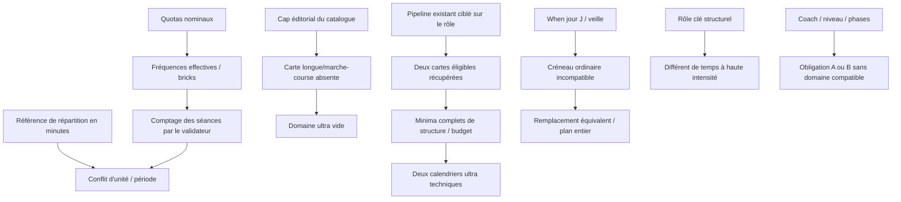

# Contradictions et témoins V6

Les problèmes sont séparés de leurs symptômes. Tous les codes, sévérités et avertissements existants restent conservés. Les regroupements diagnostiques ne changent aucune classification sportive.

## Ratios disciplinaires : unité et période

`src/engines/plan/planValidator.ts::validateSportRatio` agrège le **nombre de séances** des semaines de charge hors course. Le brick contribue à vélo et course par `round(nombre_total_de_bricks × 0,5)`. Ce comptage ne représente ni des minutes ni nécessairement le nombre de séances physiques. Le test d'un brick parmi quatre séances physiques expose un dénominateur de cinq après les deux arrondis ; c'est un témoin d'unité, pas une preuve d'universalité physiologique.

`supabase/functions/ai-training-plan/sportRatioMatrix.ts` présente explicitement les répartitions dans des tables **[NNN] min / [%]**, notamment dans les instructions de validation des ratios. Le contrôle actuel et cette présentation n'utilisent donc pas la même grandeur. Les cibles sont reprises sans élargissement dans les contrats candidats V6.

Témoin : `IM:untrained:finisher:known_synthetic`, variante `standalone_preserve`, semaines de charge. Le vélo vaut environ 28,6 % des séances mais 45,4 % des minutes d'endurance. La natation vaut 28,6 % des séances mais 15,0 % des minutes. Cela ne rend pas automatiquement conforme la course ni les autres règles.

Trois contrats comparés, **sans effacer l'alerte originale** : fréquence de référence ; minutes d'endurance des semaines de charge ; minutes de tout l'entraînement. Les courses et le renforcement ne sont pas inclus dans le dénominateur des minutes d'endurance. Les composantes vélo/course d'un brick ne sont utilisées que si connues et cohérentes avec son total ; sinon sa durée reste dans le dénominateur et produit des bornes, sans partage proportionnel inventé.

Les bornes algébriques des quotas sont des témoins limités aux mêmes plages et au même patron de bricks. Elles ne prouvent pas qu'aucune autre méthode d'entraînement ne fonctionnerait.

## Trail : contradiction irréductible par simple changement d'unité

Les quinze calendriers course/renforcement V5 valent 100 % de course parmi les disciplines d'endurance, en séances comme en minutes. Les bornes hautes existantes de 70–80 % ou 65–80 % ne peuvent être satisfaites en gardant ce calendrier sans autre discipline. Aucun vélo n'est ajouté pour obtenir un meilleur score. Une règle de vélo optionnel/spécificité trail doit être discutée séparément de la règle de ratio.

Les règles de séances A/B des semaines de base se heurtent également aux phases et plafonds d'intensité des fixtures. Des strides, de la technique et du renforcement ne deviennent pas artificiellement des blocs de seuil. Une fiche d'audit de répartition n'est pas utilisée comme séance pour satisfaire un test. Les trois alertes de catégorie des semaines de base restent visibles dans les nouveaux ultras.

## Ultra : absence de catalogue ou perte de rôle ?

L'attribution du pipeline prouve que `A_TR_MARCHE_COURSE_ULTRA` est écartée par `fill_sport_cap`, et `A_TR_SL_PEAK` par les caps de remplissage sport/catégorie, malgré leur présence dans la bibliothèque et leur éligibilité pour les cas entraînés. La condition d'alternance marche/course du prototype et la phase peak exigent précisément ces rôles.

La correction récupère uniquement ces deux fiches par **le pipeline existant**, avec les mêmes interdictions, filtres de niveau, phases et contrôles. Les métadonnées restent intactes. Les composants écrits imposent au moins 210 minutes : 15 + 180 + 15, malgré une borne globale débutant à 180. La réservation du budget utilise aussi ce minimum réel.

Résultat : deux calendriers complets pour les fixtures entraînée et très entraînée. Le niveau non entraîné ne peut pas atteindre la dose du rôle long de base avec son plafond actuel ; le niveau léger reste sous les minima des longs spécifiques. Ces refus sont limités aux contrats et données présents, pas à l'impossibilité générale de préparer un ultra.

## Placement et séances clés

41 occurrences V5 concernent des fiches réservées au jour de course ou à la veille utilisées en semaine ordinaire. 32 ont au moins une option de même dose dans le domaine préparé ; neuf n'en ont pas dans ce domaine strict. Le réparateur n'explore que cette cause, avec au plus quatre propositions par plan, contrôlées sur le plan complet.

Les indicateurs `isKeySession` sont conservés exactement. Le rôle long/structurant et la haute intensité ne sont pas synonymes ; les avertissements de cohérence qui révèlent cette tension restent émis. Le contrôle de polarisation est relu comme une estimation en minutes à partir des clauses, avec sa part inconnue, jamais comme un ratio de séances ou une durée exacte inférée des seules zones.
