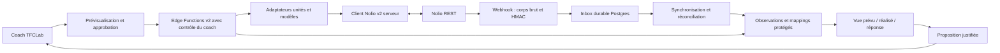

# TFCLab — Architecture recommandée pour Nolio v2

Décision proposée au 24 octobre 2026 ; **spécification seulement**, à valider avant toute implémentation. Sources, SHA du code et empreinte du contrat dans la [matrice](NOLIO_V1_V2_MIGRATION_MATRIX.md). A = explicite ; B = documenté sous conditions ; C = à confirmer. Tous les noms de nouveaux modules/tables ci-dessous sont des propositions TFCLab.

## 1. Choix directeur

Conserver React/Vite, Supabase/Postgres/RLS et Deno Edge Functions. Ajouter une intégration v2 à côté de la v1, avec un client serveur et des adaptateurs purs. Aucun nouveau backend général, bus distribué ou réécriture des modèles physiologiques. Les entrées Nolio deviennent des observations contextualisées ; les calculs scientifiques TFCLab restent propriétaires de leurs hypothèses, méthodes et niveaux de confiance.

Nolio est la source des activités, capteurs, réponses et de l'état de son calendrier. TFCLab est la source des plans brouillons, de la doctrine, des analyses et des décisions enregistrées. Une séance publiée a une histoire partagée : une édition distante ne perd pas sa légitimité parce que TFCLab l'avait créée.

## 2. Applications et authentification

| Option | Contrat A/B | Adaptation TFCLab et choix |
|---|---|---|
| Personnelle + PAT | Compte du propriétaire et athlètes coachés ; Bearer ; OAuth rejeté `pat_required` ; scopes PAT ≤ application | **Situation 1 : choix initial recommandé** si un compte Nolio responsable couvre les athlètes Two For Coaching. Provisionnement futur manuel autorisé séparément, stockage serveur. Le coach TFCLab utilisateur reste authentifié et autorisé ; un PAT partagé n'autorise pas tous les utilisateurs TFCLab |
| Équipe + OAuth2 | Une seule équipe ; seuls ses membres peuvent autoriser ; départ/pause → 403 `team_membership_required` ; managers gèrent l'app ; périmètre limité à cette équipe | Préférer dès le départ seulement si plusieurs coachs doivent disposer d'identités et d'une gouvernance Nolio distinctes. Ne pas partager le PAT personnel d'un coach pour simuler ces délégations. Restriction multi-coachs d'écriture à lever explicitement dans Nolio par le manager |
| Partenaire + OAuth2 | Application produit, bloquée à la création ; examen Nolio → développement limité à **5 comptes connectés** ; second examen → production | **Situation 2 : cible** pour coachs externes. Une connexion par compte autorisé, isolée par tenant/coach. Consentement partiel et réautorisation nécessaires quand scopes augmentent. Pas d'OAuth inutile à implémenter tant que la situation 1 suffit |

Le changement PAT → partenaire n'est pas une simple conversion de token : nouvelle application/configuration, nouveaux consentements, mapping et réconciliation. Les identités doivent être vérifiées dans le contexte de chaque application ; ne pas présumer que les IDs ou autorisations seront transférables sans contrôle. L'abstraction `CredentialProvider` doit gérer `personal_pat`, `partner_oauth`, `team_oauth`, avec une seule interface d'accès au token côté serveur.

Pour OAuth futur : Authorization Code, échange serveur `/api/token/`, scopes demandés minimaux, `state` aléatoire opaque conservé sous forme de hash avec utilisateur TFCLab, redirect URI autorisée, expiration et consommation unique. PKCE obligatoire clients publics, recommandé même pour le backend confidentiel ; secret jamais dans le navigateur. Codes partenaire valides 10 min, tokens 24 h selon `info.description`; utiliser `expires_in` réel. L'URL de consentement et les codes de callback peuvent transiter dans le navigateur ; **aucun access token, refresh token, PAT ou secret client** n'y est exposé.

Refresh central avec marge de 60–120 s, verrou de connexion/lease SQL, persistance atomique access+refresh+expiration/version. En cas de rotation de refresh token, le perdant recharge la version gagnante ; ne réutilise pas une ancienne valeur. Un 401 OAuth permet un seul renouvellement et un seul nouvel essai sûr. Échec définitif → `reauthorization_required`. Un 401 PAT désactive le traitement et demande reconnexion/rotation ; pas de refresh OAuth. Ne pas revenir silencieusement à un token expiré.

### Scopes minimaux et accès effectif

- Phase lecture : `planned:read`, `real:read`, `metrics:read`. `/me/athletes/`, `/me/groups/`, `/sports/`, zones finales et catalogue métrique s'ouvrent avec les scopes d'univers pertinents décrits sur chaque route ; ajouter `settings:read` seulement pour paramètres/profils complets nécessaires. `team:read` seulement pour administration de membres/équipes, `library:read` seulement pour bibliothèque distante.
- Phase export : ajouter `planned:write`. `planned:delete` est une habilitation distincte, seulement si annulation/suppression autorisée : elle est nécessaire à la récupération de lots qui ont touché planned. Pas de `real:write`, `metrics:write`, `settings:write` implicite.
- Bibliothèque distante facultative : `library:read/write`, `library:delete` si suppression/undo. Synchronisation de zones en écriture = décision explicite et `settings:write` ; aucune activation automatique.
- Écarter `billing:*`, `marketplace:*`, `messaging:*`, `team:write/delete` du périmètre initial. Les commentaires athlètes `debrief.comment` sont déjà dans le réalisé ; le besoin de lire des conversations est distinct.
- L'application neuve commence avec neuf scopes de lecture ; réduire ses clés/grants au besoin, ne pas conserver tout le catalogue par facilité. Chaque requête reste soumise au grant, à l'application, au PAT, au rôle et au consentement de l'athlète.
- `/app/` accepte PAT ou OAuth et expose scopes effectifs et budget. `/app/users/` et administration webhook exigent **PAT**, y compris quand les données sont lues via OAuth. `app:manage` concerne la gestion des clés et n'est pas à ajouter aux grants de tous les coachs. Le texte webhook autorise n'importe quel PAT valide de l'application indépendamment des scopes de données. Confirmer avec Nolio le provisionnement de ce PAT d'administration pour les modes OAuth, particulièrement équipe (C).

`has_api_access=false` interdit d'aller chercher les données. Un athlète listé n'est pas automatiquement lisible. Les anciens athlètes archivés ne sont pas gérés : accès passé aussi refusé. Une équipe multi-coachs refuse par défaut toutes écritures/suppressions sur les athlètes ; lectures possibles. Un manager doit autoriser les scopes correspondants dans Nolio ; TFCLab explique le refus et ne le contourne pas. Un événement individuel destiné à plusieurs athlètes reste non modifiable via ces routes (403) : publier une occurrence par athlète pour préserver l'individualisation.

### Secrets, révocation et gouvernance

PAT et secret OAuth dans les secrets Edge pour le cas personnel simple, puis coffre privé chiffré pour les connexions multiples (Vault/enveloppe avec clé hors DB publique, selon capacités Supabase retenues). Tables privées sans privilèges `authenticated`/`anon`, sans vue exposant les ciphertexts ; service-role uniquement après vérification du sujet et des droits locaux. Une vue/route de statut renvoie mode, état, scopes et dates, jamais le secret. Stocker seulement la référence du secret dans la connexion.

Prévoir deux emplacements de configuration pendant une rotation autorisée, test de lecture du nouveau token, bascule puis révocation de l'ancien côté Nolio ; pour OAuth, déconnexion locale et retrait du grant côté Nolio sont distincts. Le contrat ne donne pas ici un endpoint universel de révocation OAuth à inventer : utiliser les réglages Nolio et confirmer procédure. Révocation/rotation PAT ne déclenche pas `access.ended` : réconcilier. Aucun de ces gestes n'est réalisé dans cet audit.

Un utilisateur TFCLab ne choisit pas arbitrairement un `usr_…` ni une URL distante. Le serveur résout `(tenant, coach, athlete_local, connection)` et vérifie le droit local de lecture/publication, puis la visibilité Nolio. Dans une équipe TFCLab, utiliser les relations d'accès coach↔athlète existantes si elles suffisent ; toute délégation nouvelle exige une table d'accès explicite, pas une confiance dans le rôle UI. La propriété actuelle `athletes.coach_id` reste en place pendant la migration.

## 3. Modules proposés et persistance minimale

`supabase/functions/_shared/nolio-v2/` : `client.ts` (HTTP et erreurs), `auth.ts` (provider), `pagination.ts`, `contracts.ts` (types dérivés du contrat), `adapters/{athlete,sport,zones,planned,real,metrics}.ts`, `publication.ts`, `reconciliation.ts`, `webhookSignature.ts`. Les adaptateurs sont déterministes, sans IA ni calcul de diagnostic.

Nouvelles fonctions `nolio-v2-read`, `nolio-v2-preview`, `nolio-v2-publish`, puis `nolio-v2-import-real`, `nolio-v2-webhook`, `nolio-v2-reconcile`. `nolio-v2-oauth` seulement lors de l'ouverture multi-comptes. Ne pas renommer les handlers v1. Séparer les routes d'écriture empêche qu'un simple chargement d'écran publie.

| Table proposée | Champs / contraintes essentiels | Protection et utilité |
|---|---|---|
| `nolio_v2_connections` | UUID, tenant/owner_coach, application_key, mode, remote_user, team optionnelle, scopes, secret_ref, expires_at, token_version, status | Métadonnées client limitées ; secrets privés. Ne pas confondre app globale et connexion d'un coach |
| `nolio_v2_athlete_links` | local_athlete, connection, application_key, `usr_id:text`, legacy_user_id nullable, access_status, checked_at | Unicité connexion+local_athlete et connexion+usr_id sauf regroupement explicitement validé ; aucun matching automatique par seul nom |
| `nolio_v2_resource_links` | application/connexion, local occurrence UUID, plan_version, type, remote_id:text, remote_athlete, legacy_id, base_revision, base_hash, last_remote_hash, last_seen_at, state | Identité d'une occurrence, **pas** ID de fiche catalogue ; unique par type+remote_id dans contexte autorisé. Séparer événements planned/real/competition |
| `nolio_v2_publications` | publication UUID, coach, plan_version, hash des opérations, références/zones utilisées, aperçu, expiry, approved_by/at, state, batch_ids | Aperçu immuable et validation métier ; payload sensible protégé, durée courte puis suppression selon politique |
| `nolio_v2_sync_operations` | UUID stable, publication/index, method/type, mapping, request_hash, remote_id, status, attempt, error_code, next_attempt_at | Unique publication+index ; états `prepared`, `approved`, `in_flight`, `succeeded`, `failed`, `unknown`, `conflict`, `compensated` ; source de vérité des résultats |
| `nolio_v2_observations` | athlète, type+remote_id, date, sport, valeurs normalisées, unités, source, restriction, linked_planned_id, fetched_at, completeness | Cache minimisé des réalisés/métriques/retours ; original ciblé conservé seulement si utile, protégé et purgable ; pas de GPS par défaut |
| `nolio_v2_sync_state` | connexion, athlète, univers/fenêtre, cursor, scan_id, couverture, completed_at | Reprise des pages, aucune suppression sur scan incomplet |
| `nolio_v2_webhook_inbox` (phase 4) | application+event_id unique, type, objet/owner résolu, reçu/traité, retry_at, statut, payload protégé à TTL court | Déduplication durable, traitement après accusé de réception, priorité aux fins d'accès |

Prévoir `app_users` en cache temporaire ou staging de scan, et registre de purge minimal sans données personnelles en clair. Une même personne accessible via plusieurs connexions ne doit pas multiplier les charges ; dédupliquer les observations par identité Nolio/application et contrôler séparément les droits de chaque tenant. Ne pas permettre de lecture inter-tenant au prétexte que les IDs correspondent.

RLS sur tables lisibles du produit, avec vérification tenant/coach/athlète et contrôle `WITH CHECK`; aucun accès client aux transitions d'approbation, secrets ou jobs. L'approbation serveur vérifie à nouveau coach et hash, elle ne repose pas sur un booléen du body. Les RPC de prise de job, refresh et purge sont restreintes ; les fonctions service-role ne déduisent jamais l'autorisation de RLS contournée.

Pas de Redis, Kafka ou nouvelle file dédiée au départ : quelques imports manuels peuvent être bornés et synchrones. Une **file durable Postgres** devient justifiée pour lots multi-chunks, attente de quota, import de plusieurs athlètes et webhooks : la table d'opérations/inbox peut suffire, avec lease et `FOR UPDATE SKIP LOCKED`, essais bornés, temporisation et reprise. C'est une fonction de synchronisation ciblée, pas un système QA généraliste.

## 4. Client HTTP, pagination et erreurs

Base URL fixe et allowlist de routes ; URL signée de fichier traitée séparément avec contrôle URL/HTTPS, redirections bornées, interdiction des réseaux internes, taille et timeout, aucun forwarding de Bearer Nolio vers une autre origine. Éviter de logger cette URL.

Listes : `limit=100` au maximum général, `starting_after` ID de dernière ligne, continuer jusqu'à `has_more=false`. Transaction locale par page ; persister page et curseur ensemble, détecter un curseur qui n'avance pas. Calendriers et valeurs : `date_from/date_to` inclusifs. Records/HRV/courbes : `from/to`. Ne pas envoyer `offset` ni les anciens `athlete_id/sport_id`.

Exceptions documentées : records = catalogue/fenêtres top N sans pagination (`has_more=false`, aucun ID de ligne) ; HRV = tableau borné, RMSSD max 366, mesures max 366 ou 31 avec raw, défaut 15, mesures sans from = 90 jours ; laps = liste complète non paginée ; streams = 204 possible. Fenêtrer explicitement les HRV, dédupliquer aux frontières et ne pas conclure à l'exhaustivité si une fenêtre atteint son plafond. Les événements d'une même date doivent être conservés.

| Réponse | Comportement recommandé |
|---|---|
| 204 streams | Absence de fichier/capteurs, pas de parsing JSON et pas d'erreur générale |
| 400 / validation_error / read_only_field | Retourner les champs précis au compilateur/coach ; pas de retry ; ne pas « corriger » l'intensité par heuristique |
| 401 | Un refresh OAuth sérialisé, sinon connexion suspendue ; PAT à renouveler explicitement |
| 403 | Distinguer missing_scope, wrong_api_version, pat_required, team_membership_required, team_scope_forbidden, athlete_api_access_denied, api_access_denied ; aucun retry aveugle ; suspendre le périmètre concerné |
| 404 | Peut masquer l'invisibilité ; confirmer contexte d'accès avant tombstone ; pas de suppression locale massive |
| 409 | Conflit révision/stale_preview/confirmation/undo : relire, refaire aperçu, nouvelle validation ; ne jamais forcer un PATCH |
| 429 | Lire Retry-After, budgets heure **et** jour, replanifier le job ; ne pas sauter de page ou convertir en zéro |
| 503 / réseau / timeout | Lectures : backoff exponentiel avec jitter et limite ; écritures : passer d'abord par la décision de résultat ambigu avant tout nouvel essai |
| 410 migration IDs | Conversion indisponible après échéance ; procédure manuelle de remapping validé, jamais conversion arithmétique |

Limiter le débit **par application**, pas par utilisateur uniquement. Enregistrer `X-RateLimit-Limit-Hour`, `Remaining-Hour`, `Limit-Day`, `Remaining-Day` après chaque réponse ; réserver du budget pour réconciliation des accès. Records : plafond additionnel 20/min, découverte comprise. Ces plafonds sont recalculés chaque nuit selon le profil du propriétaire et les nombres d'athlètes et de comptes connectés. Aucun quota horaire/journalier fixe n'est fourni. Le coût d'un lot N opérations est N+1, simulation incluse ; prévisualisation+publication = **2N+2** par chunk. Ajouter lectures, conversions d'IDs et récupération. Si budget insuffisant, réduire le lot ou attendre ; une journée de quota épuisée n'est pas résolue par un retry toutes les secondes.

Journal technique : ID de corrélation interne, route modèle sans ID personnel, code/status, latence, nombres d'opérations, budget et retry. Pas de bodies, noms, tokens même partiels, signatures webhook, questionnaires, fichiers ou coordonnées. L'historique métier contenant un différentiel utile au coach reste distinct, RLS, limité aux personnes autorisées et inclus dans la purge.

## 5. Préserver la prescription à l'export

### Représentation interne et contrat réel

Conserver les `ParsedSession` et structures existants en entrée ; compiler vers une représentation d'export interne versionnée contenant occurrence UUID, discipline, date civile, heure éventuelle, durée/distance/unités, étapes, intensités, récupérations, notes et références scientifiques. Cette représentation est indépendante des DTO Nolio et du texte IA. Doctrine des domaines : `src/lib/zones/tfclDoctrine.ts` uniquement, conformément à `AGENTS.md`.

| Élément TFCLab | Ce que le contrat v2 confirme | Traitement et limite |
|---|---|---|
| Athlète et date | `athletes:[usr_…]`, `date_start:YYYY-MM-DD`, `time:HH:MM` ou `moment`, jamais les deux | Une occurrence par destinataire ; dates civiles sans conversion de fuseau ; tests dimanche/lundi, fin d'année, DST ; calcul d'ancrage conservé et affiché |
| Discipline | `sport:spt_…`, sport actif chez l'athlète ; `SettingsSportUser.id=spu_…` n'est pas un sport | Catalogue + mapping explicite ; plus de constantes 2/14/18/19/20/52 en protocole v2 ; vérifier `is_structured_workout_enabled` |
| Durées et distances | Quantités durée s/min/h, distance m/km/mi ; lecture s/km | Convertir unités une fois, contrôler totaux contre étapes ; garder durée et distance quand elles sont connues, sans inventer vitesse pour les compléter |
| Étape simple en zone | Exemple `/batch/` : `kind:step`, `duration:{value:40,unit:min}`, `targets:[{type:zone,zone:2}]` | Forme illustrée, seulement après vérification de la correspondance zone/stream ; un numéro de zone seul n'assure pas la doctrine TFCLab |
| Répétitions et récupérations | Nœud `repeat` nommé, `workout:array<object>` | Propriétés du repeat, compteur, enfants, durée de repos, cible absente : **C**, obtenir schéma. Ne pas traduire `type:repetition` par simple renommage |
| Intensités absolues / % / doubles cibles / rampes | `MetricsItem.key` et `is_wb_compatible` documentent les références compatibles ; zones finales disponibles | Syntaxe de targets, unités, base de %, associations de streams, rampes non spécifiées : **C**. Garder références et afficher ce qui ne peut être certifié |
| Renforcement et formats spécifiques | Noms exercise, superset, emom, for_time, amrap dans description | Détails d'exécution non spécifiés : **C**. Pas d'export automatique complexe ni conversion arbitraire en steps |
| Compétitions | Ressource `/planned/competitions/`, `goal_type:a|b|null`, event, location, workout possible | Publier comme compétition, pas séance ordinaire ; séparer objectifs TFCLab et représentation Nolio |
| Cycles | `/planned/cycles/`, dates début/fin | Adaptateur de phases facultatif ; ne pas convertir chaque note en cycle |
| Enchaînement vélo→course, transitions | Plusieurs séances datées et descriptions possibles | Aucun champ contractuel de liaison/ordre de jambes planned trouvé ; représentation fidèle native multisports non garantie. Proposer occurrences séparées avec lien interne et ordre explicité, **seulement après accord coach sur cette représentation** |
| Notes, nutrition, consignes | description/plain text ; description_html pour modifier un texte formaté déjà présent | Conserver informations utiles, pas les commentaires de debug. Ne pas utiliser description pour masquer une perte de structure |

Les conversions v1 qui ajoutent une minute de repos en natation, convertissent des distances en durée ou substituent une zone FC à une cible doivent être **évaluées**, pas automatiquement reconduites. La migration de transport n'autorise pas à modifier la prescription. Une séance non représentable reçoit un état bloquant et une raison ; export textuel seulement si le coach le demande explicitement et accepte la perte identifiée.

### Publication sûre et idempotence

1. Le coach choisit athlète, version de plan, périmètre, date et disciplines. Le serveur résout les liens et permissions ; relit calendrier, détails nécessaires, `with_revision=true`, zones et sports.
2. Le compilateur construit des opérations immuables : création sans `?athlete=` et audience dans le body ; modification/suppression avec `?athlete=usr_…` ou contexte group dans le path. Comparaison à la dernière base synchronisée ; tout écart distant non intégré devient conflit.
3. Distinguer creates, updates, deletes ; aucun delete-before-create. Préparer des lots ≤100, idéalement petits au pilote. Pas d'opération référençant un ID créé plus tôt dans le même lot. Créer les prérequis dans une étape distincte autorisée si nécessaire. Exclure récurrences des lots : leur édition est refusée par `/batch/`.
4. Appeler `POST /api/v2/batch/` avec `dry_run:true`. Lire **tous** les `results[index].status/body`, pas seulement HTTP 200. Une erreur bloque la publication du lot TFCLab proposé ; corriger puis resimuler. Aucun envoi de notification ne doit résulter de la simulation selon contrat.
5. Présenter au coach les dates exactes, disciplines, structures, cibles et bases, totaux, changements/suppressions, conflits résolus, pertes éventuelles acceptées et possibilité réelle d'annuler. Enregistrer son approbation explicite liée au hash, utilisateur, connexion, version, révisions et expiration de l'aperçu. Toute modification invalide l'approbation. **Un plan IA généré n'est jamais publié automatiquement.**
6. Publication seulement après approbation serveur encore valide et vérification des accès. REST : ne pas supposer le `confirm_token` réservé obligatoirement au passage MCP ; si disponible et applicable, l'utiliser selon confirmation Nolio. Pour PATCH/DELETE protégés, transmettre révision documentée dans le contexte supporté ; les PATCH sont explicitement couverts par If-Match / query revision. Pour DELETE, vérifier la garantie de révision sur l'opération concernée, puis prélecture/comparaison si nécessaire. Aucun « force » silencieux.
7. Marquer in_flight avant appel ; persister les succès et IDs **par opération**, les erreurs et le `batch_id` après réponse. Lot non atomique : chaque opération a son savepoint ; une erreur ne retire pas les succès. Le coach voit la réalité, jamais un compteur « toutes envoyées » fondé sur HTTP 200. Les chunks d'un plan n'ont aucune transaction globale.
8. Réessayer seulement les échecs certains après nouvelle simulation/approbation adaptée. Timeout/réponse perdue = `unknown`, verrou de publication maintenu, réconciliation des événements et `recovery/batches` si accessible. Sans idempotency key contractuelle ni `id_partner`, un hash de nom/date n'est pas une identité fiable ; ne jamais republier des créations ambiguës. En l'absence de preuve d'unicité, demander résolution coach avant reprise.
9. Offrir annulation **uniquement** si `is_undoable=true`, après inspection de `recovery/batches/{id}/`, fenêtre/date_expires encore valide et permissions. POST undo inverse créations/suppressions, ordre inverse et transaction tout-ou-rien pour le lot. Modification ayant changé une valeur → lot non annulable ; données team-owned non récupérables via API pour le moment ; seul compte exécutant peut annuler, scopes delete requis ; perte d'accès peut bloquer. Notifications envoyées non rappelées.
10. Pour une mise à jour non annulable : conserver la base nécessaire à un éventuel correctif présenté au coach. Ce correctif est une nouvelle écriture contrôlée, jamais un rollback promis ; conserver les IDs de nœuds workout maintenus lors du PATCH.

Les contraintes temps réel de conflits ne sont pas une garantie d'atomicité de l'ensemble du calendrier : même après aperçu, des modifications concurrentes restent possibles, particulièrement entre créations. Garantir le blocage des écrasements par révision et rendre les conflits de planning visibles ; demander à Nolio la portée REST exacte de stale_preview (C).

## 6. Import réalisé : provenance avant interprétation

Pipeline : lire trainings **et** competitions → normaliser source/restrictions/unités → rapprocher par `planned` → stocker observations et couverture → produire comparaisons descriptives → proposer une analyse. `planned=null` reste activité non rapprochée ; ne pas l'attribuer automatiquement à la séance du jour. Si rapprochement heuristique nécessaire, afficher candidats et faire confirmer.

- **Observé** : fichier/capteur importé, durée/distance déclarée, RPE/sensation déclarés, date et source. Une saisie manuelle est une déclaration, pas une mesure capteur.
- **Dérivé Nolio** : Coggan/Foster, CTL/ATL/TSB, distribution en zones, records et statistiques, avec méthode et origine lorsque documentées.
- **Dérivé TFCLab** : comparaison, charge/calculs internes, estimation de seuils, modèles de performance. Enregistrer inputs, version de méthode et confiance.
- **Interprétation coach/scientifique** : diagnostic ou ajustement proposé ; ne découle jamais automatiquement d'un seul CTL, RMSSD ou record.

`load.coggan_source=rpe` rend Coggan dépendant de RPE/durée : ne pas compter Coggan et Foster comme deux preuves indépendantes. `manual`, `workout`, `power`, `pace`, `heart_rate`, `rpe` sont des origines différentes. Null peut signifier non calculable, zéro normalisé en null, capteur absent ou restriction ; utiliser `restriction.fields` et disponibilité, ne pas remplacer par zéro.

Importer de préférence agrégats et debrief d'abord, streams/laps seulement sur demande d'analyse. Le niveau d'échantillonnage n'est pas garanti à 1 Hz ; `stream_time` gouverne les durées et synchronisations, unités lues dans `units`. Ne pas supposer qu'un stream court autorise une interpolation scientifique sans contrôle. Les séances multisports agrégées ne doivent pas être additionnées à leurs jambes récupérées par ID.

Pour le prévu/réalisé, conserver une base « approuvé/publié » et une vue « prévu courant dans Nolio ». Sinon une modification après réalisation efface la preuve de ce qui était initialement prescrit. Une séance passée sans réalisé est **non rapprochée**, pas automatiquement non faite ; l'annulation ou non-exécution nécessite observation explicite ou confirmation coach.

## 7. Webhooks, conflits et continuité

### Vérification exacte

Lire `request.arrayBuffer()` **avant tout JSON.parse**. Extraire `t` et le(s) `v1` du header `Webhook-Signature: t=<unix>,v1=<hex>`, valider format, taille et timestamp. Calculer HMAC-SHA256 avec secret applicatif sur les octets de `ASCII(t + '.') || rawBody`. Comparer le digest aux 32 octets hex décodés via primitive de vérification cryptographique en temps constant (`crypto.subtle.verify` HMAC en Deno, ou primitive équivalente documentée). Rejeter longueurs/hex invalides avant comparaison ; ne pas utiliser `===` sur les signatures. Tolérance 5 minutes proposée par la doc, horloge surveillée et paramétrage testable. La déduplication sur event_id complète la protection contre replay.

Après vérification seulement : parser, valider enveloppe minimale `{id,type,created,data.object}`, résoudre application et périmètre, insérer inbox atomiquement. Accuser 2xx **après** persistance ; erreur de persistance → non-2xx pour retry. Un doublon déjà stocké → 2xx. Les événements inconnus sont ignorés sans bloquer le flux ; ne pas leur accorder d'écriture arbitraire.

Nolio retente 5 fois sur environ 3 heures ; après 20 livraisons consécutives épuisées, webhook désactivé automatiquement. Surveiller via GET configuration avec PAT serveur ; réactivation future contrôlée. Les événements pendant désactivation/pause/abonnement propriétaire inactif ne sont pas rejoués. `access.ended` obligatoire n'échappe pas à ce problème de disponibilité.

### Ordre, concurrence et reprise

- Abonner explicitement créations/modifications/suppressions planned et real, compétitions/cycles nécessaires, metrics.value.* et événements de membres/groupes utiles. Le défaut ne livre que créations/mises à jour de trainings. Aucun événement de quiz_results/HRV/records n'est nommé dans le catalogue : polling ciblé, pas webhook inventé.
- Objet de changement = forme REST GET, suppression = `{id,is_deleted:true}` seulement. L'enveloppe n'a pas de séquence garantie ; `created` ne suffit pas à ordonner strictement. Stocker mapping de contexte avant besoin des deletes, et mettre en quarantaine un événement sans contexte sûr plutôt que choisir le premier coach.
- Traiter un changement comme signal d'invalidation ; relire la ressource autorisée et comparer hash/révision courante. Ne pas appliquer un vieux payload sur une observation récente. Sur delete tardif, vérifier existence/contexte avant tombstone pour éviter qu'un événement ancien supprime une ressource restaurée.
- Sérialiser par application+ressource. L'event_id déduplique les livraisons ; le remote_id déduplique les objets ; le publication_id déduplique les intentions TFCLab. Ce sont trois identités différentes.
- Boucle d'écho : une modification TFCLab revient par webhook ; intégrer le nouvel état/hash sans déclencher une publication inverse. Aucun appel Nolio depuis un simple observer React.
- Initialisation : inbox active, scan borné des athlètes autorisés et des deux calendriers, traitement du backlog puis second passage de fenêtre ; poursuivre jusqu'à convergence sans prétendre à un snapshot transactionnel global.
- Incrémental : curseurs de scan et inbox durable, reprise de leases ; réconciliation récente quotidienne, historique par rotation et lecture des événements liés à tout plan actif, y compris dates futures. Cibles proposées à ajuster au budget, pas des limites Nolio.
- Différentiel à trois versions : base synchronisée, état TFCLab courant, état Nolio courant. Un seul côté changé → import ou proposition de mise à jour ; deux côtés changés → conflit explicite avec choix coach (garder Nolio / nouvelle proposition TFCLab / fusion présentée). Même des changements sur champs différents doivent être revus si le workout complet est remplacé.

| Donnée | Source opérationnelle retenue | Politique |
|---|---|---|
| Plan brouillon, analyse, domaines physiologiques | TFCLab | Jamais remplacés par un indicateur Nolio |
| Calendrier publié, texte/cible modifiés dans Nolio | État partagé, Nolio fait foi pour son état courant | Importer le changement et signaler divergence du plan initial ; PATCH seulement avec révision et accord |
| Réalisé, capteurs, debrief, questionnaire | Nolio pour l'observation importée | Cache TFCLab en lecture ; pas de réécriture des déclarations athlètes |
| Zones | TFCLab pour doctrine ; Nolio pour configuration actuelle de son compte | Correspondance versionnée ; proposition de changement contrôlée, aucune synchronisation autoritaire implicite |
| Compétitions/objectifs | Nolio pour date/calendrier distant, TFCLab pour analyse de l'objectif | Fusion explicite des changements ; préserver hiérarchie a/b et données coach |
| Autorisations | Nolio + droits locaux TFCLab | Le plus restrictif prévaut |

### Fin d'accès et suppression obligatoire

Sur `access.ended` (`revoked`, `link_ended`, `account_deleted`) : arrêter immédiatement import, export et traitements dépendants ; annuler jobs en attente, marquer purge prioritaire. Supprimer **toutes les données détenues concernant l'utilisateur sous ce périmètre contractuel dans les 30 jours**, incluant données brutes, caches, fichiers, snapshots/records/agrégats dérivés, journaux métier, payloads inbox/publications et exports conservés. Une conservation générique de données TFCLab concernant cette personne n'est pas une exception présumée aux conditions : clarifier le périmètre juridique avec Nolio, sans retarder la suppression des données concernées. Ne rien supprimer chez Nolio. Réception répétée après purge = no-op.

Recenser copies de fichiers, sauvegardes et caches navigateur ; purge logique des stores actifs puis expiration/crypto-effacement des copies selon politique validée compatible avec 30 jours. Empêcher une restauration de sauvegarde ou un ancien job de réintroduire les données. Si cette compatibilité n'est pas démontrable, l'exploitation v2 reste bloquée.

Réconcilier quotidiennement proposé `/app/users/` avec le PAT d'administration, **toutes les pages dans un même passage** car liste recalculée à chaque page. Une panne, une page manquante ou un 401 n'est pas une preuve d'absence et ne déclenche pas de purge massive. Marquer candidats absents, confirmer par un second scan complet rapproché sous budget, traiter avant 30 jours depuis la détection avec marge ; ne pas utiliser cette confirmation pour prolonger le délai d'un access.ended reçu. Les rotations de clés, réduction de scopes, suppression/archivage de groupes n'émettent pas toujours access.ended. `is_paused=true` garde le lien et les données mais bloque les appels : pause ≠ fin d'accès. Un événement de départ d'équipe ne prouve pas à lui seul la fin de toutes voies d'accès.

**Cette capacité de purge et de réconciliation doit exister avant tout import réel persistant**, même si le système événementiel complet arrive en phase 4 : commencer par reconciliation `/app/users/` en phase 1 et ajouter le récepteur minimal access.ended avant ouverture aux données réelles.

## 8. Vérification et limites contractuelles

Types générés depuis l'OpenAPI 3.1 épinglé, validation JSON Schema compatible 2020-12 pour les parties spécifiées, fixtures synthétiques. Les types seuls ne vérifient ni entitlements ni fidélité des workouts. Accommoder de façon ciblée les divergences connues texte/schéma (streams optionnels, RR, token aperçu), avec tests et liste de réserves ; ne pas accepter tout JSON par un `any` général.

Tests prioritaires : isolation de deux coachs, refus d'athlète, scope manquant, refresh concurrent, unités et nulls/restrictions, calendriers complets incluant courses, 204 streams, pagination/reprise, publication partielle, réponse perdue, édition distante protégée, HMAC raw bytes/replay, access.ended et purge de dérivés. Garder les suites physiologiques existantes en non-régression sans modifier les algorithmes. Aucune nouvelle QA généraliste.

Questions contractuelles à lever avant export complexe : schéma détaillé de tous nœuds/cibles/workout, compatibilité par sport/montre, bornes de répétitions/imbrications et récupération, représentation native des enchaînements, token/stale_preview REST, garantie éventuelle d'idempotence de création, provisioning PAT d'administration OAuth/équipe, comportement des restrictions sur agrégats/records, unité/raw HRV et incohérences signalées. Les questions restantes ne justifient pas d'inventer des capacités ; elles déterminent les gates du [plan de réalisation](NOLIO_V2_IMPLEMENTATION_PLAN.md).
