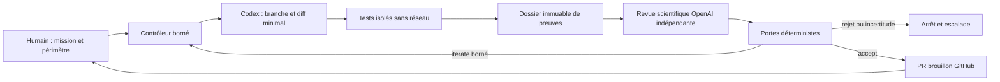

# Préparation de la collaboration semi autonome TFCLab

Cette PR propose la gouvernance, un workflow inactif et un prototype de portes
déterministes. **Aucune automatisation payante ou récurrente n'est installée.**
Le moteur sportif et ses fondations ne changent pas.

Extension A1 : [adaptateur OpenAI désactivé et préparation des cas](A1_READINESS.md).
Politique spécifique : 3itérations/30minutes/0USD par défaut, sans activation.

## Architecture



Le cycle ci-dessus est l'architecture cible. Replay, simulation et arrêts
restent offline ; A1 ajoute un client de revue configurable et désactivé,
pas un agent de correction autonome.
Pas de faux service permanent adossé à cette conversation ChatGPT.

| Livrable | Emplacement |
|---|---|
| Inventaire et limites acquises | [STATE_OF_VALIDATION.md](STATE_OF_VALIDATION.md) |
| Critères sportifs et preuves | [SPORT_SCIENCE_CONTRACT.md](SPORT_SCIENCE_CONTRACT.md) |
| Plafonds et arrêts | [QUALITY_GATES.md](QUALITY_GATES.md), `policy.json` |
| Responsabilités et itérations | [ITERATION_PROTOCOL.md](ITERATION_PROTOCOL.md) |
| Décisions | [DECISION_LOG.md](DECISION_LOG.md) |
| Workflow proposé, **non découvert par Actions** | `workflows/sport-quality-offline.yml.disabled` |
| Portes et budget local testés | `scripts/quality/gates.mjs`, `gates.test.mjs` |
| Schéma et prompt de revue proposés | `scientific-review.schema.json`, `SCIENTIFIC_REVIEW_PROMPT.md` |
| Démonstration du défaut Q1 | `src/test/__audit__/qualityLoop.demo.test.ts` |

## Reproduire la démonstration sans API

Depuis le commit exact de cette PR, dépendances déjà installées avec le lockfile :

```sh
node scripts/quality/gates.test.mjs
TFCL_QUALITY_DEMO_OUT=/tmp/tfcl-quality-demo npx vitest run --maxWorkers=2 src/test/__audit__/qualityLoop.demo.test.ts
```

Les sorties `demo.json` et `decisions.jsonl` contiennent SHA, état Git, hashes de
fixture/test/candidat simulé, mesures et décisions. La simulation corrige le
calcul seulement dans un **test double**. Aucun commit moteur candidat n'existe.
Cas attendus : baseline S8=95/S12=0, simulation165/87, legacy30 conservé, repos0.
L'avis favorable mocké donne `demo_only`, pas un GO scientifique ; avis rejeté
malgré tests verts, régression injectée, plafond d'itérations et budget zéro arrêtent.
Si le défaut de minutes est déjà corrigé lors d'une mission future, la démonstration
s'arrête avec `no_baseline_defect` au lieu d'exiger la persistance du bug.

Un run avec `trackedDirty=true` est une expérience de développement, pas une
attestation du commit. Pour le livrable final, rejouer après commit propre et
consulter les artifacts CI sur ce même HEAD. Les hashes prouvent l'intégrité,
pas l'authenticité d'un auteur ou la vérité d'une affirmation scientifique.

## Coûts et limites

Aujourd'hui : **0 appel API**. Budget configuré : **5 EUR maximum par mission**,
5 itérations maximum ; appels API toujours désactivés. Actions peut consommer
des minutes selon le compte ; aucun coût d'hébergement ou d'abonnement n'est inclus.

Exemple futur, hypothétique : cinq itérations, un appel Codex borné à16k tokens
d'entrée/4k sortie et un appel scientifique de mêmes bornes par itération. Aux
tarifs Standard courts consultés le25/10/2026, `gpt-6.1-sol` à2/10 USD par million
entrée/sortie et `gpt-6-astra` à10/50 donnent :

```text
codage     0.016 ×2  + 0.004 ×10 = 0.072 USD/appel
revue      0.016 ×10 + 0.004 ×50 = 0.360 USD/appel
5 itérations × (0.072 + 0.360)   = 2.160 USD
```

Exemple comptable, **pas un devis d'une session CLI Codex** : plusieurs tours
peuvent multiplier les requêtes. Les10 appels comprennent tous les retries ; un
11e est refusé. Tarifs, modèle réellement accessible, classe de service, contexte,
taxes/surcharges doivent être confirmés par le propriétaire ; modèle non approuvé
ou comptage inconnu = arrêt. Le plafond configuré de5 EUR ne remplace pas l'admission
par requête. Le total illustratif en USD doit être converti avec un taux EUR/USD
conservateur, daté et approuvé, surcharges incluses ; aucun taux réel n’est fixé
par cette proposition. Sans données de conversion, arrêter. Aucun engagement monétaire n'est garanti par un timeout seul.

Sources officielles : [tarifs](https://developers.openai.com/api/docs/pricing),
[comptage des tokens](https://help.openai.com/en/articles/4936856-understanding-and-counting-tokens),
[Codex non interactif](https://developers.openai.com/codex/noninteractive/),
[action Codex](https://developers.openai.com/codex/github-action/),
[sorties structurées](https://developers.openai.com/api/docs/guides/structured-outputs),
[rétention des données](https://developers.openai.com/api/docs/guides/your-data).
La disponibilité d'une API officielle ne prouve pas les droits du compte TFCLab.
`store:false` ne supprime pas nécessairement les journaux d'abus ni toutes les
formes de rétention ; aucune donnée athlète ne doit être transmise par défaut.

## Configuration humaine ultérieure

1. Examiner cette PR, ses critères et son périmètre. Fusion éventuelle uniquement
   sur autorisation explicite ; ne pas fusionner #406 pour cette préparation.
2. Autoriser séparément une première mission manuelle offline. Après revue,
   copier éventuellement le template dans `.github/workflows/`, figer les actions
   tierces par SHA vérifié, puis créer **uniquement** la variable de garde offline.
   Aucun `schedule`, `push`, `pull_request_target` ou déclencheur sur commentaire.
3. Avant API : confirmer modèles/version, tarifs, plafond, rétention et données
   autorisées ; utiliser seulement une identité OpenAI déjà gérée et autorisée.
   S'il n'y en a pas, rester bloqué : cette mission n'autorise ni création de
   secret ni transmission d'une clé dans le chat. Ne pas réutiliser les secrets
   Lovable/Supabase/Nolio pour cette boucle.
4. Implémenter et faire réviser dans une mission distincte le courtier d'admission
   durable, l'isolation réseau, la validation de provenance, le contrôleur et le
   job de création de PR. Rien de cela ne doit être remplacé par des commandes
   arbitraires sorties du modèle.
5. Configurer GitHub avec `contents:read` pour mesure/revue ; writer séparé avec
   les seuls droits branche/PR. Environnement de revue protégé pour l'activation
   initiale ou changement sensible, branche de contrôle protégée, approbation des
   changements de gouvernance et refus des PR de forks dans les jobs avec secrets.
   Les permissions GitHub d'écriture ne distinguent pas à elles seules création
   de PR et fusion : imposer des règles de branche/rulesets réservant les mises
   à jour de main aux responsables autorisés, sans bypass pour l'identité de la
   boucle. L'absence d'une commande de merge n'est pas cette protection serveur.
6. Faire un essai API borné explicitement autorisé ; il doit s'arrêter sur usage
   inconnu, dépassement ou incertitude. Une récurrence ultérieure exige une autre
   décision ; elle n'est pas impliquée par l'autorisation de cet essai.

## Verdict de préparation

GO pour examiner la proposition et reproduire la démonstration offline.
**NO-GO pour une boucle API active**, tant que courtier, isolation, provenance et
configuration humaine ne sont pas validés. Cette limite est volontaire : ne pas
présenter quelques fichiers YAML et un avis modèle comme un système sûr déjà actif.
